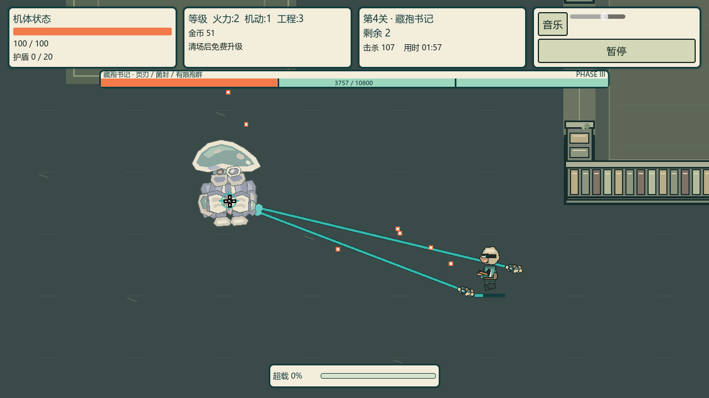
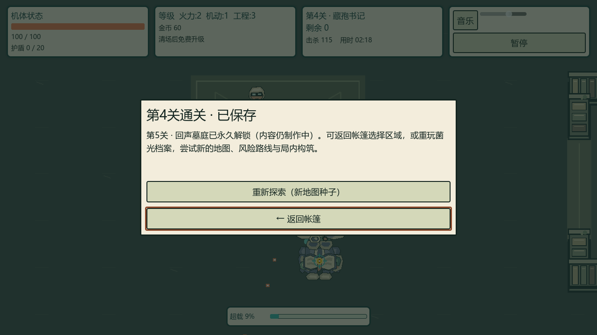

# 菌光档案 A5：正式章流与正常输入通关

2026-10-11；整体 goal active，当前 Main READY [1,2,3,4]。A5完整工程/正常输入章流门通过；第五/六关未正式制作、不可启动。原生资源仍 draft，不称整个项目完成或真人通过。不提交/推送中间节点，不替换旧 EXE、不改真实存档。

## 实现与审查

ArchiveChapter 是共享 ChapterRun 的薄适配，只负责章号4与真实 spore_field 绑定。ChapterRunDefinitions 使用真正的 luminous_archive 场景、ArchiveEncounterDirector 与第四关说明/两路线/Boss提示；没有复制共享奖励、死亡、重玩、返回和原子保存流程，也没有把本关特例塞进 Main。

正式入口需永久清3且内容就绪。真正已死、属于本场的藏孢书记才允许保存清4→解锁5；活首领伪信号、提前/错误/重复通关不能造进度。原子写入失败不显示假解锁，暴露重试按钮，成功后不跳到6。重玩保留进度且生成新种子，死亡/返回不改永久保存。第五关已解锁也显示制作中，不能误进旧波次。

测试先行：`archive-chapter-red-v1.log` 真正第四场景缺失；`archive-chapter-launch-red-v1.log` 第四入口未就绪。二者是语义RED，不把脚本解析错误当有效RED。接上场景/策略后控制夹具231检查通过，再登记候选4；正式Main入口11检查。继承的Salt测试诊断前缀仍可能出现SaltChapterTest，正通过标记明确为ArchiveChapterTest，不改变受控测试的范围。旧SaltChapterTest在清3后现应允许4；未清3的SaltChapterLaunchTest仍必须拒绝4。Salt只读恢复作者工具也更新此就绪契约，旧捕获保持历史原样。

五轴复核：薄适配复用权威章流，无新运行依赖或外部资产；准备路径只使用缺失的隔离证据保存/测试PID保存，拒绝覆盖；保存/重入/出生债务/失败已覆盖。受控战斗直接致死仅证明事务，明确不证明普通通关。独立包跑器复用既有导出/错误/大小/哈希门，增加受约束的附加夹具参数，避免复制另一套打包逻辑；PowerShell解析0错误。

## 当前两条普通输入实战

实际 Main → 区域选择 → ArchiveChapter；GPU SubViewport收到真实引擎指针、按钮、移动、射击与冲刺输入。只在开局前准备隔离的1/2/3前置通关；没有写玩家属性/位置/无敌、局内金币/奖励、直接伤害或调用假死亡。私有驾驶策略不修改游戏RNG；记录实际新地图种子。

| 路线 | 实际种子 | 检查 | 相邻真实位移 | 真实主射击 | 指针核对 | 击杀 |
| --- | ---: | ---: | ---: | ---: | ---: | ---: |
| 补给 | 4259645018 | 16284 | 8045 | 1833 | 8061 | 67 |
| 风险 | 1997924464 | 17051 | 8421 | 2085 | 8440 | 115 |

两条路线均真实清除必经遭遇、通过实际奖励按钮选择构筑、击败10800生命的当前Boss，实际保存清4/解锁5；风险额外第三遭遇。真实终态分别在step8108/8489，实际终态退出0且唯一正通过标记，无引擎错误/泄漏。两次各独立新进程7项恢复，保存SHA只读不变；从旧第三关普通通关证据保存复制出的新隔离夹具另7项恢复通过。旧证据与真实玩家存档均未写入。

当前交付 [补给报告](previews/campaign/archive-chapter-flow-v1/supply/report.json) / [风险报告](previews/campaign/archive-chapter-flow-v1/risk/report.json)，每份43个当前源SHA；每路线960×540、1280×720、1920×1080实际介绍页，完整状态及周期画面。共48文件复制逐SHA一致（补给22、风险26），含各恢复报告；报告内部build路径对应同名交付文件，保持原始报告字节不改写。读图检查实际人物/身体/血条、书架隔断、首领/阶段、奖励/路线/通关页，正文和返回按钮完整；没有声称所有密集场景/每帧标记永不遮挡。

## 当前总门

- 完整串行回归：`archive-chapter-complete-full-v1.log`，终态0，**251 Godot / 231837断言、36 Python / 272测试**，无错误/泄漏标记。断言数受实际随机遭遇数量影响，以本轮实际终态为准。
- 当前独立PCK：`archive-chapter-complete-pack-v1.log`，终态0；25专项/3325检查、Main120，通过外部复制夹具、真实生产资源，仅`--main-pack`而无`--path`。覆盖实际第四章/入口/保存、1–3章回归、共享流程及书记三招/有限后代/取消/名册。不借用旧A4包。
- 包 **6,560,944字节**，SHA256 `4968a2c0232bbf3b1a9183321ea3272ee1a4a5e6bf5718bc159415de3b4a3976`；当前release排除/30MB/Main120检查通过，同字节大小，测试和作者资源不导出。
- 新的本机原生候选：`build/playtest/5分钟超载-native-a5-v1/five-minute-overdrive.exe`（109,019,648字节，SHA256 `b5972ed3389906d857e60315308e18d3474bab4eeaa3a32a00bf637643cfc4d0`）。同目录PCK逐SHA等于以上25专项包。真正EXE不带`--path`/外加`--main-pack`，自行加载相邻PCK，headless Dummy Main120实际退出0、无错误/泄漏；不是仅确认进程存在，更不是EXE真人通关。export与startup日志保留；旧v13修改时间/字节大小保持原值，未混包。
- 当前两路线43源SHA与48文件复制通过；冻结名册两文件SHA保持原值。

## 边界与下一步

以上是引擎内正常输入而非 Windows桌面鼠标、真人手感/难度认可、性能采样或连续六关输入链。两个局部运行没有覆盖全部构筑/随机种子/密集压力；保持M6总门待验，不因100生命通关推断难度合格。没有加入新外部美术，仍为原创纸偶资源，旧音效许可未核定不能自动说全许可通过。

A5总门已齐备，发送一次Gmail后按 [第五关计划](../../tasks/echo-fifth-chapter-plan-v1.md) 推进回声墓庭地图。第五关拥有未接入正式章节的两族资源和非生产首领基础资源，不把它们算关卡完成。第六关和长期构筑/密集性能/许可总审仍待完成。

Gmail本节点仅发送一次成功（工具确认isError=false，消息ID `1a128cbc18290ff6`）；不重发上轮A4，不把已发送说成用户已阅读。文档更新后的状态4测试/台账7测试通过；没有新增运行源码导致当前包与普通输入源SHA漂移。
